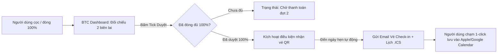

# CÓC SÀI GÒN — ANTI-AI-SLOP DESIGN SYSTEM & SPECIFICATION (v1.0)
## Storyboard Experience · Design Principles & Event System Blueprint

> **Triết lý nền tảng:** Một website sinh nhật CLB có cá tính, mang dấu ấn hoạt động sinh viên, có chiều sâu thị giác và cảm giác được con người thiết kế có chủ đích.
> 
> **Editorial** (Bố cục như tạp chí & photobook) · **Playful** (Trẻ trung, chuyển động có chủ đích) · **Human-made** (Ảnh thật, nội dung thật, đồ họa có nguồn gốc từ văn hóa CLB Cóc Sài Gòn).

---

## 01. DESIGN PHILOSOPHY (TRIẾT LÝ THIẾT KẾ)

Website phải tạo cảm giác như người dùng đang bước vào một **cuốn kỷ yếu sống động (interactive photobook)** được chuyển hóa thành một không gian tiệc sinh nhật tương tác.

### Ba từ khóa thiết kế cốt lõi
1. **Editorial:** Bố cục có nhịp điệu như một tạp chí hoặc photobook; sử dụng khoảng trắng có chủ đích, typography lớn lệch trục và lưới bất đối xứng có nhịp điệu.
2. **Playful:** Có tính vui nhộn, trẻ trung, chuyển động mang lại niềm vui khám phá thay vì phô diễn kỹ thuật vô nghĩa.
3. **Human-made:** Sử dụng ảnh tư liệu thật, con người thật, câu chuyện thật, chi tiết đồ họa phỏng theo chất liệu in ấn (giấy in kỷ yếu, tem dán vintage, con dấu, vé sự kiện, nét vẽ tay).

### Những điều tuyệt đối tránh (Anti-AI-Slop Rules)
* ❌ **Không dùng template SaaS / AI-generated landing page:** Tuyệt đối tránh dải màu gradient tím - xanh làm chủ đạo.
* ❌ **Không biến mọi thành phần thành card bo góc:** Tránh lạm dụng `rounded-2xl` lồng card trong card; không dùng icon trong ô vuông màu nhạt chỉ để lấp khoảng trống.
* ❌ **Không dùng số liệu, hình ảnh hoặc nội dung giả:** Không dùng placeholder vô nghĩa, quote bịa đặt hoặc số liệu đếm ảo (fake metrics).
* ❌ **Không animation mọi thứ chỉ vì có thể:** Tránh hiệu ứng `hover:scale-105` hàng loạt, không dùng hạt bụi (particle background) vô nghĩa.
* ❌ **Không hy sinh khả năng đọc để lấy hiệu ứng thị giác:** Mọi thông tin cốt lõi (thời gian, địa điểm, mức phí, hướng dẫn chuyển khoản) phải rõ ràng, tương phản cao và dễ thao tác.

---

## 02. ART DIRECTION & COLOR PALETTE

Thay vì dùng nền đen tối giản kỹ thuật số dạng SaaS thông thường, hệ thống sử dụng **bảng màu xúc giác (Tactile Editorial Palette)** phỏng theo giấy in mỹ thuật và màu nhận diện truyền thống của Cóc Sài Gòn:

```text
+------------------+------------------+------------------+------------------+
|    COC YELLOW    |    INK BLACK     |   PAPER CREAM    |    BRICK RED     |
|     #F4C542      |     #20231F      |     #F4EEDF      |     #B94D35      |
+------------------+------------------+------------------+------------------+
| Primary Accent   | Foreground / Ink | Background Paper | Secondary Accent |
+------------------+------------------+------------------+------------------+
```

### Bảng mã màu Tokens chuẩn

| Token Name | Mã Màu (Hex) | Vai Trò & Công Dụng |
| :--- | :--- | :--- |
| **`--color-primary`** | `#F4C542` | **Cóc Yellow**: Nút CTA chính, màu áo nhân vật Cóc, viền tem, điểm nhấn thương hiệu |
| **`--color-background`**| `#F4EEDF` | **Paper Cream**: Nền giấy in mỹ thuật tự nhiên, giảm chói mắt, tạo cảm giác analog |
| **`--color-foreground`**| `#20231F` | **Ink Black**: Màu mực in cho typography, tiêu đề, nội dung đọc chính (tương phản 13.5:1) |
| **`--color-secondary`** | `#B94D35` | **Brick Red**: Chi tiết trang trí, con dấu kỷ niệm, cảnh báo quan trọng, tag Cựu TV |
| **`--color-muted`**     | `#DCD5C4` | **Muted Stone**: Đường kẻ phân cách (hairline), viền tem thư, viền ảnh polaroid |
| **`--color-surface`**   | `#EAE4D6` | **Warm Parchment**: Khu vực nội dung phụ, thiệp mở ra, nền input form, thẻ bài viết |

### Tỷ lệ phân bổ màu sắc (60 - 25 - 10 - 5)
* **60% Nền sáng (`#F4EEDF`):** Không gian giấy kem thoáng đãng, ấm áp.
* **25% Màu mực tối (`#20231F`):** Trọng lượng thị giác từ typography, hình bóng nhân vật, đường nét vẽ tay.
* **10% Sắc vàng Cóc (`#F4C542`):** Điểm nhấn năng lượng của màu áo truyền thống.
* **5% Màu nhấn phụ (`#B94D35`):** Con dấu đỏ, ruy băng kỷ niệm, điểm nhấn cảm xúc.

### Cảm hứng thị giác (Visual References)
* **Editorial scrapbook:** Ảnh chụp kỷ niệm đính kèm băng keo trong suốt, giấy in có vân thớ nhẹ, bố cục tiêu đề bất đối xứng.
* **Retro event poster:** Kiểu chữ lớn dứt khoát, độ tương phản cao, bố cục như một ấn phẩm poster sự kiện nghệ thuật.
* **Hand-drawn mascot:** Chú Cóc Áo Vàng với biểu cảm sinh viên dí dỏm, đường viền mực in thủ công thay vì 3D render bóng bẩy.
* **Analog memories:** Ảnh chụp hoạt động thật qua các mùa, hiệu ứng hạt phim (film grain) rất nhẹ, khung ảnh mang tỉ lệ tự nhiên (3:2, 4:3, 1:1 không đồng nhất).

---

## 03. TYPOGRAPHY SYSTEM

Typography là linh hồn điều hướng của phong cách Editorial. Tối đa không quá 3 font family trong cùng một viewport.

```css
/* Typography Token Setup */
:root {
  --font-display: "Be Vietnam Pro", -apple-system, sans-serif;
  --font-body: "Be Vietnam Pro", -apple-system, sans-serif;
  --font-editorial: "Playfair Display", Georgia, serif;
  --font-label: "IBM Plex Mono", monospace;

  /* Fluid Size Steps */
  --step-label: clamp(0.75rem, 0.72rem + 0.15vw, 0.813rem);   /* IBM Plex Mono 12-13px */
  --step-body: clamp(0.938rem, 0.90rem + 0.20vw, 1.063rem);   /* Be Vietnam Pro 15-17px */
  --step-editorial: clamp(1.125rem, 1.05rem + 0.35vw, 1.375rem); /* Playfair Display 18-22px */
  --step-subhead: clamp(1.25rem, 1.15rem + 0.50vw, 1.75rem);  /* Be Vietnam Pro 20-28px */
  --step-display: clamp(2.25rem, 1.80rem + 2.50vw, 4.5rem);   /* ExtraBold Display 36-72px */
}
```

| Vai Trò | Font Đề Xuất | Trọng Lượng (Weight) | Đặc Điểm & Ứng Dụng |
| :--- | :--- | :--- | :--- |
| **Display** | `Be Vietnam Pro` | ExtraBold (800) | Tiêu đề lớn, câu khẩu hiệu sự kiện, số năm "17Y". Có thể viết hoa toàn bộ |
| **Body** | `Be Vietnam Pro` | Regular (400) / SemiBold (600) | Nội dung tiếng Việt, nhãn form, văn bản đọc. Ưu tiên khả năng đọc tối đa |
| **Editorial** | `Playfair Display` | Italic (400) / Bold (700) | Quote kỷ niệm, thư ngỏ cá nhân hóa, lời chúc trang trọng |
| **Label / Meta** | `IBM Plex Mono` | Medium (500) | MSSV, thời gian, số tiền VietQR, mã vé check-in, số điện thoại |

### Quy tắc sử dụng Typography
* **Không tracking-tight mặc định:** Chỉ giảm tracking nhẹ đối với tiêu đề Display cỡ lớn (`tracking-[-0.02em]`); Body text giữ tracking tự nhiên (`tracking-normal`).
* **Không lạm dụng outline text hoặc chữ nghiêng:** Chỉ dùng italic cho các đoạn trích dẫn (quote/editorial) hoặc lời dặn dò hóm hỉnh.
* **Tôn trọng tiếng Việt:** Bộ font được chọn hỗ trợ trọn vẹn dấu thanh tiếng Việt mà không bị lỗi chân chữ (clipping glyphs).

---

## 04. LAYOUT SYSTEM & STORYBOARD (5 SCENES)

Không gian web được cấu trúc thành **5 phân cảnh liên tục (Storyboard Experience)** mô phỏng trải nghiệm lật giở một cuốn kỷ yếu sinh nhật tương tác:

```text
+-----------------------------------------------------------------------------------+
| SCENE 01: MEMORY WALL (Phố Kỷ Niệm Full-Screen, Ảnh Lớn, Ẩn Giá Vé Ngoài)         |
+-----------------------------------------------------------------------------------+
                                         │  (Bấm "Đăng ký tham dự")
                                         ▼
+-----------------------------------------------------------------------------------+
| SCENE 02: WELCOME GATE (Bìa Thiệp Mở Ra, Nhập MSSV/Họ Tên -> Lời Ngỏ Riêng)     |
+-----------------------------------------------------------------------------------+
                                         │  (Xác nhận vai trò)
                                         ▼
+-----------------------------------------------------------------------------------+
| SCENE 03: REGISTRATION & PAYMENT (Functional Layout: VietQR Động + Form Thông Tin)|
+-----------------------------------------------------------------------------------+
                                         │  (Upload biên lai & tiếp tục)
                                         ▼
+-----------------------------------------------------------------------------------+
| SCENE 04: WISH GATE (Tâm Điểm Bánh Sinh Nhật & Bảng Viết Lời Chúc)               |
+-----------------------------------------------------------------------------------+
                                         │  (Gửi lời chúc)
                                         ▼
+-----------------------------------------------------------------------------------+
| SCENE 05: CELEBRATION STAGE (Quân Đoàn Cóc Áo Vàng Spawn + Nhạc Tiệc + Duyệt Vé)  |
+-----------------------------------------------------------------------------------+
```

### Chi tiết các Scene:

#### Scene 01: Memory Wall (Bức Tường Kỷ Niệm)
* **Bố cục:** Editorial Full-screen. Ảnh tư liệu lớn, collage xếp lớp nhẹ, tiêu đề 17Y lệch trục có chủ đích.
* **Không khí & Âm thanh:**
  * BGM tiệc sinh nhật nhẹ nhàng, nút xoay vinyl toggle Mute/Play ở góc trang.
  * Hiệu ứng ảnh polaroid: Kèm năm tháng và chú thích thật từ các mùa 14Y, 15Y, 16Y, Teambuilding.
* **Chính sách Ẩn Giá Vé:** Bề mặt ngoài tuyệt đối **không hiển thị con số giá vé**; chỉ có thông điệp tinh thần, thời gian, địa điểm và nút mời gọi định danh.

#### Scene 02: Welcome Gate (Cổng Chào & Thiệp Chào Mừng)
* **Bố cục:** Invitation layout mô phỏng phong bì mở ra (`paper unfolding`).
* **Định danh thông minh từ Google Sheet:**
  * Người dùng nhập MSSV hoặc Họ tên -> Tra cứu dữ liệu đồng bộ.
  * Tự động cá nhân hóa danh xưng (`Anh`, `Chị`, `Bạn`) và năm gia nhập (K12, K13, ..., K20).
* **Nội dung phân hóa sâu sắc:**
  * *Cựu thành viên:* Lời ngỏ tri ân, ấm áp, đưa người tiền bối "trở về nhà".
  * *Thành viên hiện tại:* Lời hiệu triệu trẻ trung, gắn kết, bùng nổ năng lượng sinh viên.

#### Scene 03: Registration & Payment (Trạm Thanh Toán & Thủ Tục)
* **Bố cục:** Functional layout, phân nhóm thông tin mạch lạc, rõ ràng.
* **Mức phí tham dự:**
  * Thành viên đương nhiệm: **349.000đ**
  * Cựu thành viên: **449.000đ**
* **Lựa chọn đóng phí linh hoạt:**
  * Đóng 100% trọn gói.
  * Đặt cọc giữ chỗ: **100.000đ** hoặc **150.000đ**.
* **VietQR Động Napas247:** Hiển thị QR chứa đúng số tiền và nội dung chuyển khoản tự động (`CSG17Y [MSSV/Ten] [SDT]`).
* **Form thông tin bảo an:**
  * Họ tên, Gmail (nhận vé), SĐT cá nhân.
  * **SĐT người thân đón về:** Trường bắt buộc kèm ghi chú thân mật: *"Số điện thoại bạn bè/người thân đón bạn về an toàn sau buổi tiệc say sưa"*.
  * **Lưu ý dị ứng thức ăn/đồ uống:** Checkbox chọn nhanh + ghi chú thực dưỡng.
* **Upload biên lai:** Khung kéo thả ảnh trực quan, tự động nén ảnh dưới 1MB.

#### Scene 04: Wish Gate (Trạm Ước Nguyện & Lời Chúc)
* **Bố cục:** Center stage với hình ảnh bánh kem sinh nhật 17 năm làm tâm điểm.
* **Khung viết lời chúc:** Tối đa 300 ký tự với các tag gợi ý lời chúc chân thật, hóm hỉnh đúng chất sinh viên Cóc.

#### Scene 05: Celebration Stage (Sân Khấu Lễ Hội Tương Tác)
* **Bố cục:** Layered stage.
* **Hiệu ứng Cóc Áo Vàng:**
  * Ngay khi hoàn tất, nổ confetti sắc vàng và chú Cóc mặc áo thun vàng thương hiệu CSG xuất hiện.
  * Bong bóng thoại (speech bubble) hiển thị tên và lời chúc của người đó.
  * Chú Cóc tự động dạo chơi trên sân khấu cùng các chú Cóc của các thành viên khác đã đăng ký trước đó.

---

## 05. COMPONENT DESIGN RULES (QUY TẮC CHẾ TÁC COMPONENT)

| Thành Phần | Quy Định Thiết Kế Anti-Slop | Tránh Tuyệt Đối |
| :--- | :--- | :--- |
| **Button** | Hình khối dứt khoát, viền mực rõ ràng, tương phản cao. Nền vàng `#F4C542` chữ đen `#20231F` hoặc nền giấy viền đậm | Không dùng button gradient 3 màu bóng loáng dạng Web3/Crypto |
| **Input** | Nền giấy (`#EAE4D6`), đường viền sắc nét, trạng thái focus có outline viền mực rõ ràng | Không dùng input xám xịt không viền, khó nhận diện trên mobile |
| **Card** | Chỉ dùng khi thực sự cần nhóm dữ liệu. Ưu tiên dùng đường kẻ mỏng (`#DCD5C4`) và khoảng trắng | Không dùng card lồng card 3 lớp bo góc tròn trịa vô tội vạ |
| **Gallery** | Ảnh đa dạng tỉ lệ (ngang, dọc, vuông), có độ nghiêng nhẹ tự nhiên như ảnh dán sổ tay | Không xếp ảnh thành các ô vuông đều tăm tắp như danh mục e-commerce |
| **Character** | Chú Cóc Áo Vàng dạng 2D vector/nét vẽ tay sinh viên vui tươi, có animation đi lại & nhảy mừng | Không dùng mô hình 3D sáp bóng bẩy, vô cảm |
| **Speech Bubble**| Nền sáng giấy, viền mực tối, giới hạn chiều rộng 220px, chữ dễ đọc | Không dùng bóng thoại mờ đục glassmorphism làm chìm mất chữ |
| **Modal** | Nhỏ gọn, phục vụ một tác vụ ngắn (như xem ảnh phóng to, tra cứu biên lai) | Không nhồi nhét toàn bộ trang web dài ngoằng vào một popup |

* **Nguyên tắc chi tiết trang trí:** Ưu tiên dùng chi tiết từ văn hóa CLB (con dấu BTC đã duyệt, sticker cóc, tem vé, mã số sinh viên mono) thay cho các icon vector vô nghĩa.

---

## 06. MOTION DESIGN (CHUYỂN ĐỘNG CÓ CHỦ ĐÍCH)

Chuyển động trong hệ thống phải phục vụ câu chuyện và phản hồi thao tác của người dùng, không bao giờ được làm chậm trải nghiệm đăng ký:

| Hành Động | Hiệu Ứng Được Chỉ Định |
| :--- | :--- |
| **Chuyển Scene** | Chuyển dịch có kiểm soát (Horizontal / Vertical smooth slide) mô phỏng lật trang kỷ yếu |
| **Mở thư chào mừng** | Hiệu ứng mở thiệp phong bì (`paper unfolding`) |
| **Gửi lời chúc** | Nhân vật Cóc Áo Vàng xuất hiện từ góc dưới + nổ confetti hạt vàng |
| **Nhân vật idle** | Nhịp thở / nhún nhảy nhẹ nhàng (`duration: 2s`) |
| **Nhân vật di chuyển** | Chuyển động bước chân qua lại trong ranh giới màn hình |
| **Rê chuột CTA** | Nâng nhẹ viền hoặc xuất hiện gạch chân vẽ tay; xúc giác nhấn nút co nhẹ `scale-[0.98]` |

* **Tiêu chuẩn hiệu năng:**
  * Tuyệt đối không fade-in hàng loạt làm chậm mắt người đọc.
  * Hỗ trợ chuẩn `@media (prefers-reduced-motion: reduce)`: Tự động tắt hoạt họa di chuyển đối với người dùng nhạy cảm chuyển động.
  * Zero Cumulative Layout Shift (CLS < 0.1): Tuyệt đối không để animation làm nhảy khung trang.

---

## 07. CONTENT & AUTHENTICITY (TÍNH XÁC THỰC CỦA NỘI DUNG)

Nội dung và hình ảnh trên website phải có nguồn gốc thực tế từ 17 năm hoạt động của CLB Truyền thông Cóc Sài Gòn:

| Được Sử Dụng (Authentic) | Không Được Sử Dụng (Artificial Slop) |
| :--- | :--- |
| ✅ Hình ảnh sự kiện thật (14Y, 15Y, 16Y, Teambuilding, F-Camp...) | ❌ Ảnh stock người mẫu Tây mặc vest không liên quan |
| ✅ Tên sự kiện, phòng ban thật (Ban Nội dung, Kỹ thuật, Sự kiện, Thiết kế...) | ❌ Tên phòng ban doanh nghiệp tập đoàn xa lạ |
| ✅ Lời chúc thực tế do người tham gia tự tay gửi lên hệ thống | ❌ Đánh giá giả (fake testimonials) tạo bằng AI |
| ✅ MSSV và danh xưng thực từ danh sách đồng bộ | ❌ Dữ liệu người dùng giả lập để lấp khoảng trống |
| ✅ Mốc thời gian tổ chức thật, địa điểm tiệc thật | ❌ Copywriting quảng cáo giật gân phong cách SaaS |

* **Tone of Voice:** Trẻ trung, nhiệt huyết, có chất sinh viên FPTU, gần gũi và đôi khi hóm hỉnh (đặc biệt ở ô nhập SĐT người thân đón khi say).

---

## 08. UX STATES & EDGE CASES (XỬ LÝ TÌNH HUỐNG BIÊN)

Hệ thống bắt buộc phải kiểm soát trọn vẹn 9 trạng thái giao diện:

1. **Default:** Trạng thái sẵn sàng, chữ rõ nét, viền mực chuẩn.
2. **Hover:** Phản hồi xúc giác tinh tế (chỉ áp dụng cho thành phần bấm được).
3. **Focus:** Vòng focus indicator màu mực rõ ràng phục vụ điều hướng bằng phím Tab (WCAG 2.2).
4. **Loading:** Thanh tiến trình hoặc con cóc xoay nhẹ nhàng khi upload ảnh biên lai.
5. **Disabled:** Phân biệt rõ bằng độ mờ và con trỏ cấm, không gây nhầm lẫn là nút bấm được.
6. **Error:** Thông báo lỗi cụ thể (VD: *"Không tìm thấy MSSV trong danh sách CLB"*, *"Biên lai phải là file ảnh định dạng JPG/PNG"*).
7. **Empty:** Trạng thái chưa có lời chúc hoặc chưa tìm thấy kết quả kèm hướng dẫn cách khắc phục.
8. **Success:** Màn hình xác nhận đăng ký thành công kèm mã vé và thông tin cọc/đóng đủ.
9. **Overflow:** Văn bản dài của lời chúc tự động cuộn hoặc thu gọn trong speech bubble, không phá vỡ khung hình.

### Các tình huống đăng ký thực tế cần xử lý
* **Người dùng chỉ mới đặt cọc:** Giao diện cung cấp cổng **"Tra cứu & Đóng nốt số dư"**. Khi quét mã đợt 2, hệ thống tự trừ số tiền cọc (VD: 349k - 100k = 249k) và cho phép upload ảnh biên lai đợt 2.
* **Upload ảnh biên lai thất bại do mạng yếu:** Hệ thống giữ lại toàn bộ thông tin cá nhân đã điền, cho phép thử upload lại mà không bắt điền lại từ đầu.
* **Người dùng tắt trình duyệt:** Lưu tạm tiến trình vào `localStorage` để khi mở lại không bị mất thông tin.

---

## 09. HỆ THỐNG QUẢN TRỊ BTC & PHÁT HÀNH VÉ QR ĐỒNG BỘ LỊCH



### 1. Phân hệ Admin Dashboard (Cổng Quản Trị Bảo Mật)
* Đăng nhập mã PIN bảo mật dành cho Ban Tổ Chức.
* Bảng thống kê tài chính thời gian thực: Tổng người tham dự, tổng quỹ đã thu, danh sách người mới cọc, danh sách người chờ duyệt biên lai đợt 2.
* **Tính năng Soi Biên Lai (Receipt Inspector):** Hiển thị song song ảnh biên lai đợt 1 và ảnh đợt 2 trên cùng một màn hình để thủ quỹ đối soát trực quan với thông báo ngân hàng.
* **Nút Tick Duyệt 100%:** Chỉ khi Admin nhấn nút này, hệ thống mới gắn cờ `is_approved_100% = true`.

### 2. Tính năng Lọc gửi vé tự động & Đồng bộ Lịch điện thoại
* **Bộ lọc phát hành vé:** Chỉ những người đã có cờ `is_approved_100% = true` mới nhận được vé mời QR. Những người chỉ mới đặt cọc sẽ không nhận được vé QR cho đến khi đóng đủ số dư còn lại.
* **Tích hợp "Add to Calendar" thông minh:**
  * **Google Calendar Link:** Tự động tạo sự kiện với đầy đủ thời gian (18:00 Thứ Bảy), địa điểm và dresscode.
  * **File iCalendar (`.ics`):** Đính kèm trong mail; người dùng mở trên iPhone hoặc Android chỉ cần bấm 1 chạm là sự kiện tự động lưu vào ứng dụng Lịch mặc định của máy, kèm chuông nhắc trước 2 giờ và trước 1 ngày.

---

## 10. AI-SLOP REJECTION CHECKLIST (BẢNG KIỂM ĐỊNH CHẤT LƯỢNG)

Trước khi xuất xưởng mã nguồn hoặc giao diện, bắt buộc phải đối chiếu danh sách sau:

- [ ] **Màu sắc:** Nền giấy kem `#F4EEDF`, chữ đen mực `#20231F`, vàng Cóc `#F4C542` làm điểm nhấn. Tuyệt đối không có nền tím nhạt / xanh neon AI cliché.
- [ ] **Bố cục:** Bố cục dạng photobook / tạp chí kỷ niệm; không gò ép mọi thứ vào lưới bento 3 cột đơn điệu.
- [ ] **Tính năng:** Đầy đủ luồng đăng ký 5 bước, phân loại Cựu TV (449k) vs Thành viên (349k), cọc 100k/150k.
- [ ] **Bảo mật giá vé:** Trang ngoài không để lộ giá vé; chỉ hiển thị sau khi định danh cá nhân.
- [ ] **Độ xác thực:** Hình ảnh tư liệu hoạt động thật từ các mùa sinh nhật cũ của Cóc Sài Gòn.
- [ ] **Âm thanh:** Nhạc nền tiệc tùng có nút bật/tắt dễ thấy ở góc màn hình.
- [ ] **Mascot tương tác:** Chú Cóc Áo Vàng xuất hiện dạo chơi trên màn hình mang theo bóng thoại lời chúc của người đăng ký.
- [ ] **Cổng Admin:** Có cơ chế đối chiếu ảnh 2 biên lai và nút tick duyệt 100% rõ ràng.
- [ ] **Vé QR:** Chỉ phát hành vé QR check-in và file lịch `.ics` cho người đã được duyệt đóng đủ 100%.

---

## 11. FINAL DESIGN PRINCIPLE (NGUYÊN TẮC CỐT LÕI CUỐI CÙNG)

> ### *"Design with intention. Every element must earn its place."*
>
> *(Thiết kế có chủ đích. Mọi chi tiết trên màn hình đều phải xứng đáng với vị trí của nó.)*
>
> Một giao diện tốt không phải giao diện nhồi nhét nhiều hiệu ứng nhất. Nó phải có bản sắc riêng, kể được câu chuyện 17 năm đầy tự hào của CLB Truyền thông Cóc Sài Gòn và giúp từng thành viên cảm nhận được sự ấm áp khi trở về nhà.

**Thứ tự ưu tiên cốt tử:**
$$\text{Authenticity (Tính chân thật)} \longrightarrow \text{Visual Hierarchy (Phân cấp thị giác)} \longrightarrow \text{Usability (Khả năng sử dụng)} \longrightarrow \text{Motion (Chuyển động)} \longrightarrow \text{Decoration (Trang trí)}$$
